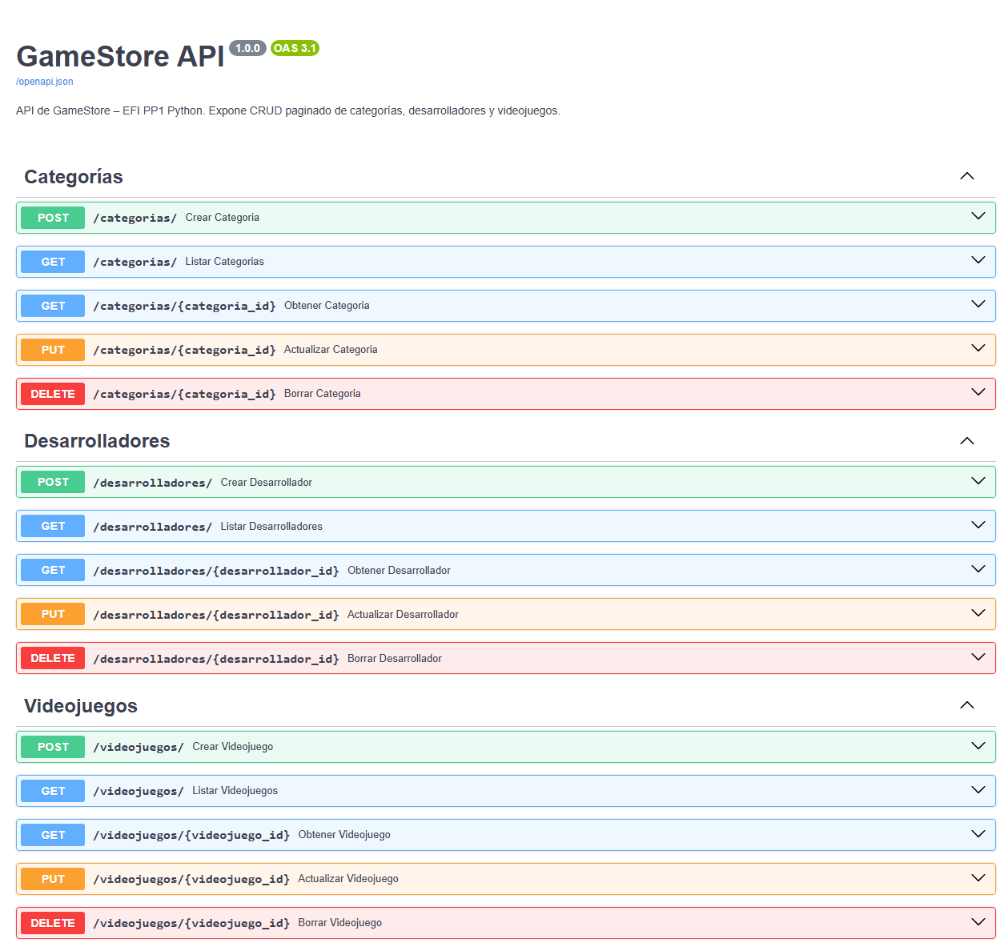
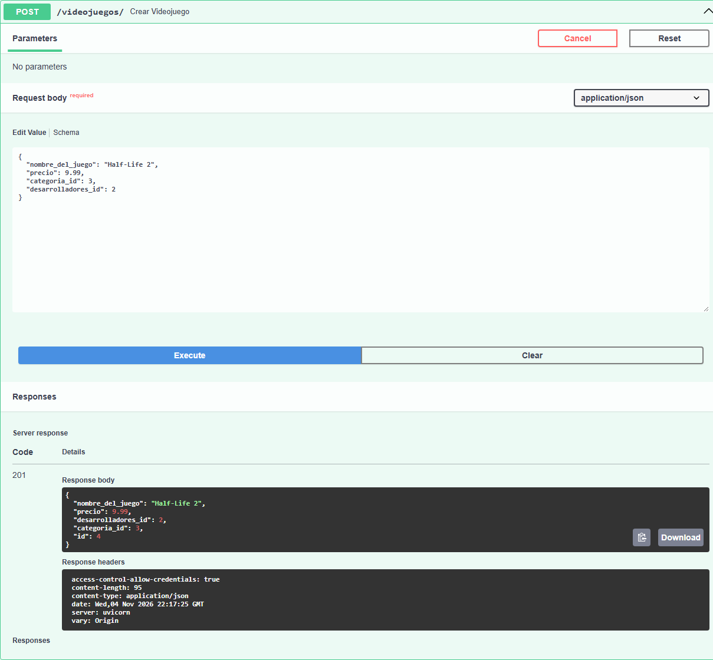
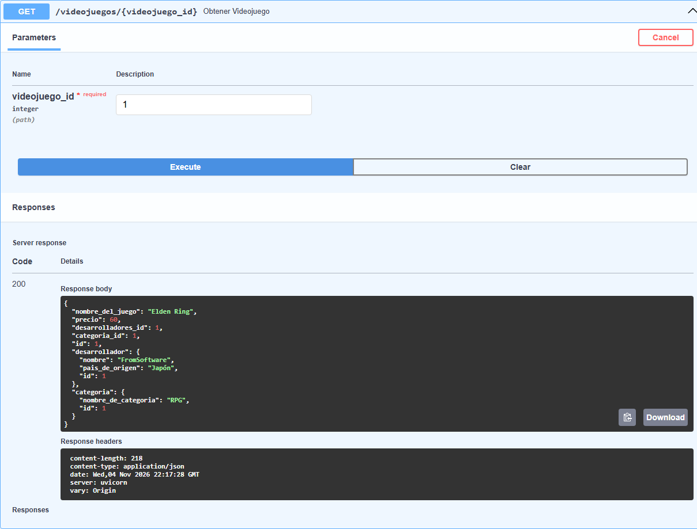
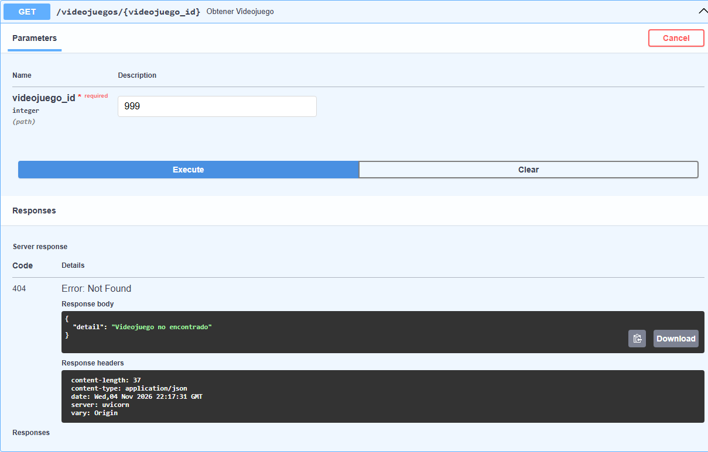
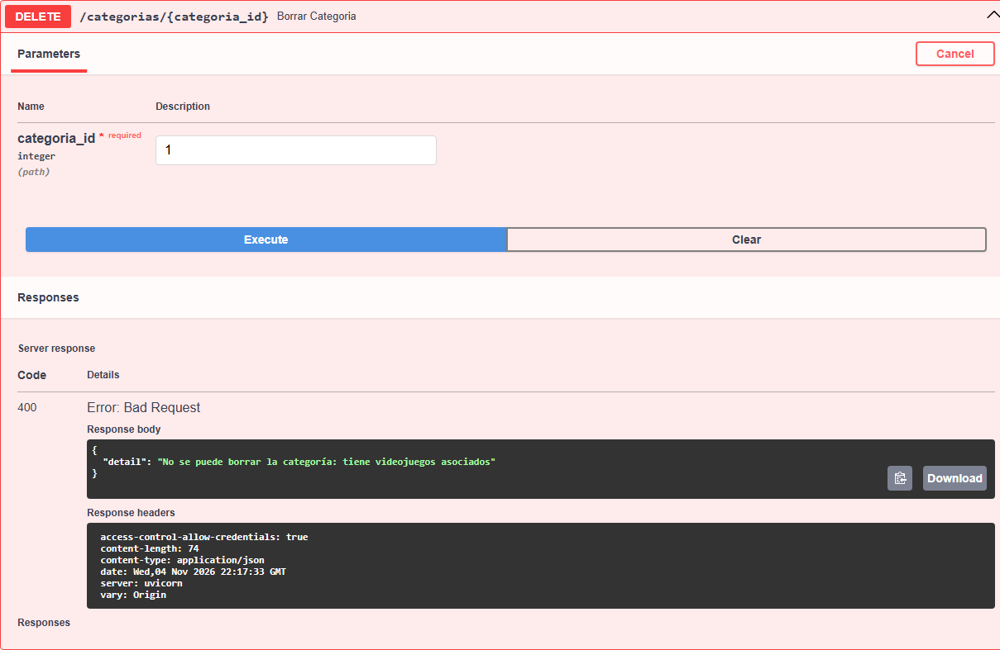

# GameStore – EFI PP1 Python y JavaScript

Repositorio de la Evaluación Final Integradora. Temática elegida: **GameStore**, una tienda de videojuegos. Tiene las dos partes del proyecto:

| Parte | Carpeta | Documentación |
|---|---|---|
| API REST (PP1 Python) | raíz del repo | este README |
| Frontend React (PP1 JavaScript) | [`frontend/`](frontend/) | [`frontend/README.md`](frontend/README.md) |

- **App publicada en Vercel:** https://game-store-sable-ten.vercel.app
- **Tablero Kanban en Trello:** https://trello.com/b/eupVrOgD/efi-gamestore

Lo que sigue documenta la **API**. Está hecha con **FastAPI + SQLModel + SQLite + Alembic + fastapi-pagination**, usando solo los temas vistos en el apunte de la materia.

## Integrantes

- Valen Marchicio
- Jacobo Zunino
- Fabri Gallardo
- Tomás Maluf

## Stack

| Pieza | Para qué |
|---|---|
| FastAPI | Framework web y documentación automática (`/docs`) |
| SQLModel | Modelos y schemas unificados |
| SQLite | Base de datos local (archivo `gamestore.db`) |
| Alembic | Migraciones de la base |
| fastapi-pagination | Paginación de los endpoints `GET` listado |
| CORSMiddleware | Permite que el frontend consuma la API |

## Tablas y relaciones

Tres tablas con dos claves foráneas, cumpliendo con la consigna.

| Tabla | Campos | Relaciones |
|---|---|---|
| `categoria` | `id`, `nombre_de_categoria` | 1 categoría → N videojuegos |
| `desarrollador` | `id`, `nombre`, `pais_de_origen` | 1 desarrollador → N videojuegos |
| `videojuego` | `id`, `nombre_del_juego`, `precio`, `categoria_id` (FK), `desarrolladores_id` (FK) | pertenece a 1 categoría y 1 desarrollador |

## Estructura del proyecto

```
GameStore/
├── alembic/
│   ├── env.py
│   ├── script.py.mako
│   └── versions/
│       └── 87db96407444_migracion_inicial.py
├── alembic.ini
├── frontend/                # app React (PP1 JavaScript), ver frontend/README.md
├── src/
│   ├── database.py          # engine y get_session
│   ├── main.py              # app FastAPI + CORS + routers + add_pagination
│   ├── models/
│   │   ├── categoria.py
│   │   ├── desarrolladores.py
│   │   └── videojuegos.py   # Videojuego + Nested de los otros 2 (evita circular)
│   └── routers/
│       ├── categoria.py
│       ├── desarrolladores.py
│       └── videojuegos.py
├── requirements.txt
├── .gitignore
└── README.md
```

## Endpoints

Todos los `GET /` devuelven `Page[XPublic]` con `items`, `total`, `page`, `size`, `pages` (parámetros `?page=` y `?size=`).

### Categorías (`/categorias`)

| Método | Ruta | Descripción | Códigos |
|---|---|---|---|
| POST | `/categorias/` | Crea una categoría | 201, 422 |
| GET | `/categorias/` | Lista paginada | 200 |
| GET | `/categorias/{id}` | Devuelve la categoría con sus videojuegos (Nested) | 200, 404 |
| PUT | `/categorias/{id}` | Actualiza campos opcionales | 200, 404, 422 |
| DELETE | `/categorias/{id}` | Borra; bloquea si tiene videojuegos | 200, 400, 404 |

### Desarrolladores (`/desarrolladores`)

Mismo contrato que categorías, con los campos `nombre` y `pais_de_origen`.

### Videojuegos (`/videojuegos`)

| Método | Ruta | Descripción | Códigos |
|---|---|---|---|
| POST | `/videojuegos/` | Crea un videojuego; valida FK | 201, 404, 422 |
| GET | `/videojuegos/` | Lista paginada con filtros opcionales `?nombre=`, `?categoria_id=`, `?desarrolladores_id=` | 200 |
| GET | `/videojuegos/{id}` | Devuelve el videojuego con `categoria` y `desarrollador` (Nested) | 200, 404 |
| PUT | `/videojuegos/{id}` | Actualiza campos opcionales; revalida FK si cambian | 200, 404, 422 |
| DELETE | `/videojuegos/{id}` | Borra | 200, 404 |

El filtro `?nombre=` usa `ilike` (insensible a mayúsculas y a parciales).

## Cómo correrlo

1. Clonar el repo y entrar a la carpeta `GameStore`.
2. Crear un entorno virtual y activarlo:

   ```powershell
   python -m venv venv
   .\venv\Scripts\Activate.ps1
   ```

   En bash:
   ```bash
   python -m venv venv
   source venv/Scripts/activate
   ```

3. Instalar dependencias:

   ```powershell
   pip install -r requirements.txt
   ```

4. Crear la base y aplicar la migración inicial:

   ```powershell
   alembic upgrade head
   ```

   Esto genera `gamestore.db` con las 3 tablas y las 2 FK.

5. Levantar la app:

   ```powershell
   fastapi dev src/main.py
   ```

   o:
   ```powershell
   uvicorn src.main:app --reload
   ```

6. Abrir la documentación interactiva en:
   - Swagger UI → http://127.0.0.1:8000/docs
   - ReDoc → http://127.0.0.1:8000/redoc

## Pensado para el frontend (PP1 JavaScript)

- El frontend está en la carpeta [`frontend/`](frontend/) de este mismo repo.
- CORS habilitado para `http://localhost:5173` (Vite), `http://localhost:5500` (Live Server) y `https://game-store-sable-ten.vercel.app` (frontend publicado en Vercel).
- El `GET /videojuegos/` acepta filtros por `nombre`, `categoria_id` y `desarrolladores_id` para que React use `useEffect` con dependencias de un formulario de búsqueda.
- Los endpoints `GET /{id}` ya devuelven el objeto con sus relaciones anidadas, listo para pintar una vista detalle sin pedir dos endpoints.

## Capturas

### `/docs` con todos los endpoints



### `POST /videojuegos/` exitoso



### `GET /videojuegos/{id}` con Nested



### Error 404



### Error 400 al borrar una categoría con videojuegos



## GitFlow usado

- `main` → rama estable, con los tags `v1.0.0` (API) y `v2.0.0` (entrega final con el frontend).
- `develop` → integra todas las features.
- `feature/*` → una por tarea, mergeadas con `git merge --no-ff` para que el historial las muestre.

Ramas de la API:

1. `feature/modelos-update-nested`
2. `feature/router-categorias`
3. `feature/router-desarrolladores`
4. `feature/router-videojuegos`
5. `feature/main-app`
6. `feature/alembic`
7. `feature/readme`
8. `feature/readme-integrantes`
9. `feature/readme-monorepo` (une el frontend a este repo)
10. `feature/cors-vercel`
11. `feature/readme-entrega`

Las ramas del frontend usan el prefijo `feature/front-*` y están listadas en [`frontend/README.md`](frontend/README.md).
